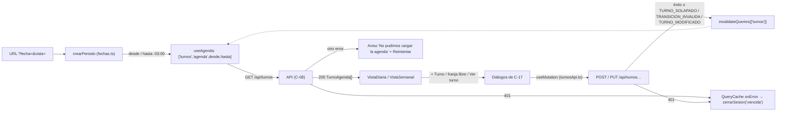

# agenda

Agenda de turnos: vista diaria y semanal (C-16, spec `web-agenda`) y gestión de turnos desde la agenda: crear, reprogramar, cancelar y registrar asistencia (C-17, spec `web-gestion-turnos`).

## Piezas

| Archivo | Qué hace |
|---|---|
| `AgendaPage.tsx` | Ruta `/`. Lee `fecha` y `vista` de la URL, arma el período, pide los turnos y muestra encabezado con "+ Turno", avisos de C-17, navegación, leyenda y la vista que corresponde con sus estados (cargando, vacío, error). |
| `api.ts` | `consultarAgenda` → `GET /api/turnos?desde=&hasta=` (C-08) y `useAgenda` con TanStack Query. Clave: `['turnos', 'agenda', desde, hasta]`. |
| `fechas.ts` | Fechas civiles `AAAA-MM-DD` en la zona del consultorio: hoy, lunes de la semana, período, `desde`/`hasta` con `-03:00` y textos ("Miércoles 2 de diciembre de 2026", "Jueves 03/12"). |
| `lineaDeTiempo.ts` | Rango visible (08:00–20:00 extendido a franjas de 30 min), recorte de turnos que cruzan la medianoche y posición en franjas. |
| `hooks.ts` | `useAhora` (se actualiza cada minuto) y `usePantallaAncha` (`min-width: 900px`). |
| `VistaDiaria.tsx` / `VistaSemanal.tsx` / `Turnos.tsx` | Línea de tiempo diaria con carril de cancelados, semana en cuadrícula (ancha) o lista (angosta), y las piezas de cada turno. Con C-17, cada turno tiene un botón "Ver turno: …" y la vista diaria, botones en las franjas libres futuras. |
| `Agenda.module.css` | Estilos según la maqueta aprobada `openspec/changes/archive/*-ui-agenda/mockups/`, solo con tokens. |
| `turnosApi.ts` | **C-17.** `crearTurno`, `reprogramarTurno`, `cancelarTurno`, `registrarAsistencia` y sus hooks `useMutation`, con la invalidación de `['turnos']`. `usePacientesParaTurno` reutiliza `buscarPacientes` de C-15 (`features/pacientes/api.ts`). |
| `gestion.ts` | **C-17.** Lógica pura: `accionesDisponibles`, `esCancelacionTardia`, hora de fin, validación del horario, franjas libres y textos de los avisos. |
| `errores.ts` | **C-17.** `interpretarRechazo`: decide si un error va a un campo, a un aviso del diálogo o a la agenda (o a ningún lado, si es 401). |
| `GestionTurnos.tsx` | **C-17.** `useGestionTurnos`: qué diálogo está abierto, el último aviso y las acciones que reciben las vistas por `AccionesAgendaContexto` (`accionesAgenda.ts`). |
| `Dialogo*.tsx`, `ComboPaciente.tsx`, `Campos.tsx`, `Alerta.tsx` | **C-17.** Diálogos "Nuevo turno", "Detalle del turno", "Reprogramar turno" y "Cancelar turno", el combobox de paciente y las piezas de formulario y avisos. `Dialogo.tsx` usa `useDialogo` de C-15 (`shared/useDialogo.ts`). |
| `Gestion.module.css` | **C-17.** Estilos según la maqueta aprobada `openspec/changes/archive/2026-11-24-ui-gestion-turnos/mockups/`, solo con variables (lo controla `app/estilos.test.ts`). |

## Contratos que usa C-17

| Operación | Llamada | Respuesta y rechazos que se tratan |
|---|---|---|
| Crear | `POST /api/turnos` `{pacienteId, prestacionId, inicio, duracionMinutos}` | 201 turno · 409 `TURNO_SOLAPADO` (`turnoEnConflicto`) · 422 `TURNO_EN_PASADO`, `PACIENTE_INACTIVO`, `PRESTACION_INACTIVA`, `VALIDACION_FALLIDA` |
| Reprogramar | `PUT /api/turnos/{id}/reprogramacion` `{inicio, duracionMinutos, version}` | 200 turno · 409 `TURNO_SOLAPADO`, `TURNO_MODIFICADO`, `TRANSICION_INVALIDA` · 422 `TURNO_EN_PASADO` |
| Cancelar | `POST /api/turnos/{id}/cancelacion` `{motivo}` o sin cuerpo | 200 turno `CANCELADO` o `CANCELADO_TARDIO` · 409 `TRANSICION_INVALIDA` · 422 `motivo` > 255 |
| Asistencia | `POST /api/turnos/{id}/asistencia` `{estado: ATENDIDO \| AUSENTE}` | 200 turno · 409 `TRANSICION_INVALIDA` |
| Configuración | `GET /api/configuracion` (`features/configuracion/api.ts`) | `horasCancelacionTardia` para el aviso previo; si falla, aviso genérico |
| Pacientes / prestaciones | `GET /api/pacientes?q=&page=0&size=10` / `GET /api/prestaciones` (funciones de C-15) | Solo activos en el diálogo |

## Flujo

## Reglas

- **Zona horaria.** Todo se calcula en `America/Argentina/Buenos_Aires` con offset fijo `-03:00` (`OFFSET_CONSULTORIO` en `fechas.ts`), nunca con la zona del navegador. La hora de cada turno se lee con `Intl` en esa zona.
- **La URL manda.** `fecha` y `vista` viven en la URL (navegar hace push, así Atrás funciona). Valores inválidos se ignoran. Sin `vista`: semanal en pantallas de 900 px o más, diaria en las angostas. Tras crear o reprogramar, la agenda va al día del turno sin cambiar de vista.
- **Cancelados.** Nunca tapan ni achican a un activo: en la diaria van en un carril angosto aparte; en la semana, listados después de los activos (RN-AG-10).
- **Toda llamada pasa por TanStack Query** (convención de C-14): el 401 lo resuelve el `onError` global; ni la agenda ni los diálogos muestran su aviso de error. Un cuerpo que no es lista se trata como error de carga.
- **Las reglas las decide el backend.** La web app solo previene errores obvios (campos vacíos, inicio pasado, duración fuera de 5–480, motivo > 255) y explica los rechazos sin códigos técnicos (`shared/api/mensajes.ts`). No predice solapamientos.
- **Refresco.** Tras cada acción exitosa, y ante `TURNO_SOLAPADO`, `TRANSICION_INVALIDA` o `TURNO_MODIFICADO`, se invalida `['turnos']` y la agenda visible se vuelve a pedir. Los dos últimos cierran el diálogo y avisan en la agenda, porque el turno abierto ya no está al día.
- **Aviso de cancelación tardía.** Se muestra antes de confirmar si faltan **menos** de `horasCancelacionTardia` (exactamente en el límite, no: RN-CA-04). Si la configuración no carga, aviso genérico; el estado final lo decide la API y el anuncio usa el estado devuelto.
- **Tests.** `src/test/agenda.ts` fija el reloj (`fijarAhora`), simula el ancho (`simularAnchoDePantalla`, jsdom no trae `matchMedia`) y la API (`simularApiAgenda`). `src/test/gestionTurnos.ts` simula el backend completo de C-17 (`simularBackend`). `turnosDePrueba.ts` arma turnos ficticios.
