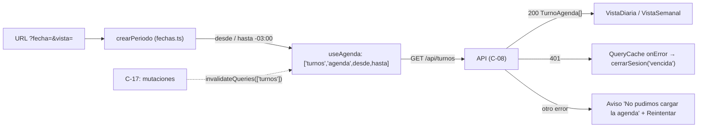

# agenda

Agenda de turnos: vista diaria y semanal (C-16, spec `web-agenda`). C-17 suma la creación, reprogramación, cancelación y asistencia.

## Piezas

| Archivo | Qué hace |
|---|---|
| `AgendaPage.tsx` | Ruta `/`. Lee `fecha` y `vista` de la URL, arma el período, pide los turnos y muestra encabezado, navegación, leyenda y la vista que corresponde con sus estados (cargando, vacío, error). |
| `api.ts` | `consultarAgenda` → `GET /api/turnos?desde=&hasta=` (C-08) y `useAgenda` con TanStack Query. Clave: `['turnos', 'agenda', desde, hasta]`. |
| `fechas.ts` | Fechas civiles `AAAA-MM-DD` en la zona del consultorio: hoy, lunes de la semana, período, `desde`/`hasta` con `-03:00` y textos ("Miércoles 2 de diciembre de 2026"). |
| `lineaDeTiempo.ts` | Rango visible (08:00–20:00 extendido a franjas de 30 min), recorte de turnos que cruzan la medianoche y posición en franjas. |
| `hooks.ts` | `useAhora` (se actualiza cada minuto) y `usePantallaAncha` (`min-width: 900px`). |
| `VistaDiaria.tsx` / `VistaSemanal.tsx` / `Turnos.tsx` | Línea de tiempo diaria con carril de cancelados, semana en cuadrícula (ancha) o lista (angosta), y las piezas de cada turno. |
| `Agenda.module.css` | Estilos según la maqueta aprobada `openspec/changes/archive/*-ui-agenda/mockups/`, solo con tokens. |

## Flujo

## Reglas

- **Zona horaria.** Todo se calcula en `America/Argentina/Buenos_Aires` con offset fijo `-03:00` (`OFFSET_CONSULTORIO` en `fechas.ts`), nunca con la zona del navegador. La hora de cada turno se lee con `Intl` en esa zona.
- **La URL manda.** `fecha` y `vista` viven en la URL (navegar hace push, así Atrás funciona). Valores inválidos se ignoran. Sin `vista`: semanal en pantallas de 900 px o más, diaria en las angostas.
- **Cancelados.** Nunca tapan ni achican a un activo: en la diaria van en un carril angosto aparte; en la semana, listados después de los activos (RN-AG-10).
- **Toda llamada pasa por TanStack Query** (convención de C-14): el 401 lo resuelve el `onError` global y la agenda no muestra su aviso de error. Un cuerpo que no es lista se trata como error de carga.
- **C-17** invalida `['turnos']` después de cada acción para que la agenda visible se vuelva a pedir.
- **Tests.** `src/test/agenda.ts` fija el reloj (`fijarAhora`), simula el ancho (`simularAnchoDePantalla`, jsdom no trae `matchMedia`) y la API (`simularApiAgenda`). `turnosDePrueba.ts` arma turnos ficticios.
