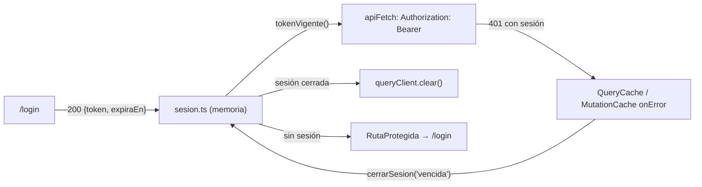

# auth

Sesión del odontólogo: inicio de sesión, token en memoria, rutas protegidas y cierre de sesión (C-14, specs `web-sesion` y `web-app-shell`).

## Piezas

| Archivo | Qué hace |
|---|---|
| `sesion.ts` | Store de la sesión en un módulo (`iniciarSesion`, `cerrarSesion`, `tokenVigente`, `useSesion`). `conectarSesionConApi()` lo conecta al cliente con `configurarProveedorToken`; se llama una vez en `main.tsx`. |
| `api.ts` | `login()` → `POST /api/auth/login`. |
| `LoginPage.tsx` | Página pública `/login`, según la maqueta `openspec/changes/ui-login/mockups/`. |
| `RutaProtegida.tsx` | Envuelve el layout. Sin sesión lleva a `/login` y guarda la ruta pedida en `state.desde`. |

## Flujo

## Reglas

- **El token vive solo en memoria.** Nunca va a `localStorage`, `sessionStorage`, cookies ni la URL. Al recargar o abrir otra pestaña hay que ingresar de nuevo; no hay refresh token en el MVP.
- **El vencimiento se comprueba al leer.** `tokenVigente()` compara `expiraEn` con el reloj. Si el token venció, cierra la sesión como `'vencida'` y la solicitud sale sin `Authorization`.
- **Manejo de 401.** `crearQueryClient()` (`src/app/queryClient.ts`) cierra la sesión como vencida ante un 401 **solo si había sesión**. Así el 401 `CREDENCIALES_INVALIDAS` del login no muestra "Tu sesión venció". Cada vez que la sesión se cierra, el cliente descarta la caché.
- **Convención: toda llamada a la API pasa por TanStack Query** (`useQuery` / `useMutation`). Una llamada directa a `apiFetch` fuera de Query no dispara el cierre por 401; el vencimiento lo sigue cubriendo `tokenVigente()`.
- **Textos.** Los mensajes de `CREDENCIALES_INVALIDAS`, `LOGIN_BLOQUEADO` y `NO_AUTENTICADO` están en `shared/api/mensajes.ts`; los títulos de los avisos, en `LoginPage.tsx`. La API no informa el tiempo restante del bloqueo, así que el aviso fija los 15 minutos de RN-AU-03.
- **Tests.** `src/test/setup.ts` reinicia la sesión después de cada test. `renderConRutas(ruta, { conSesion: true })` arranca con una sesión de prueba.
